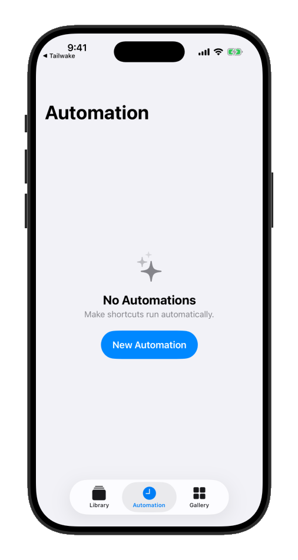
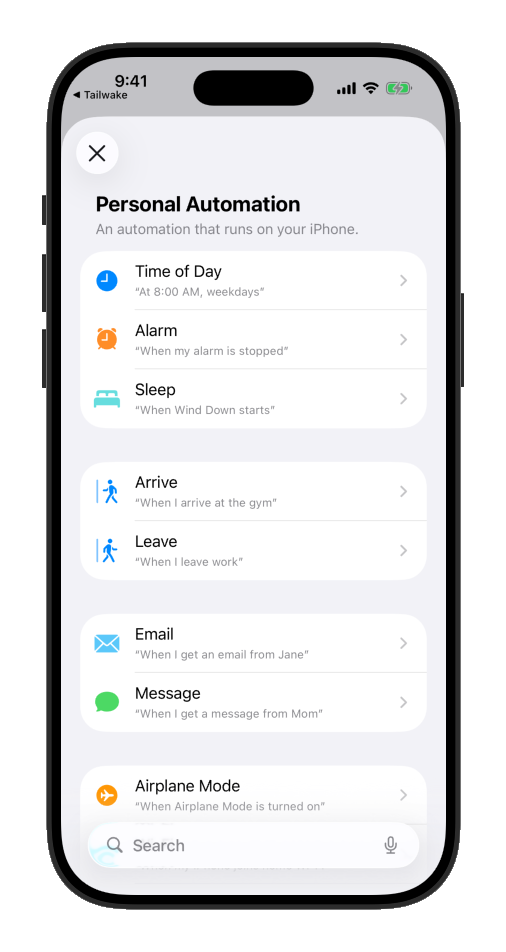
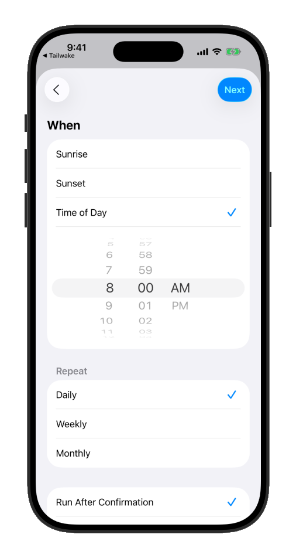
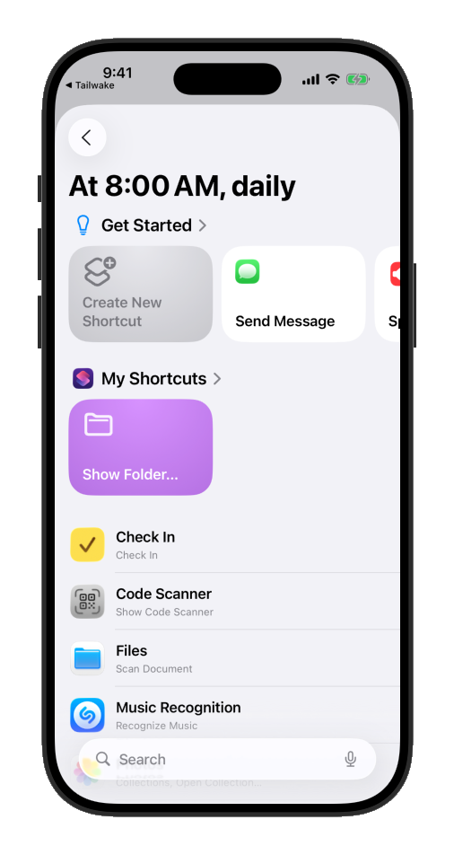
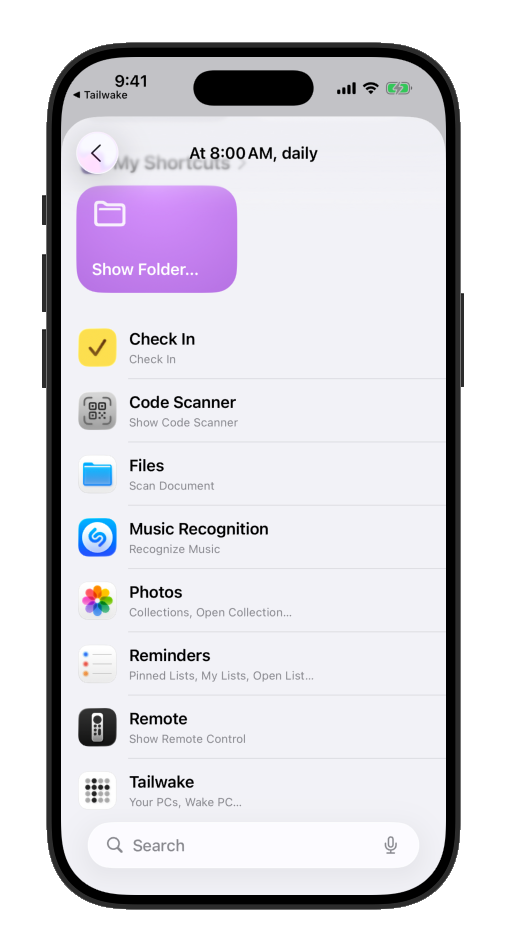
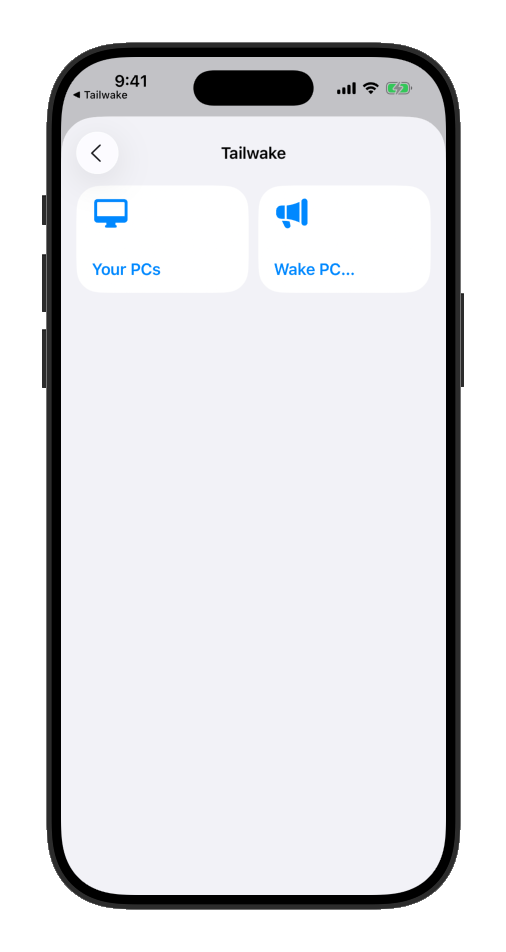
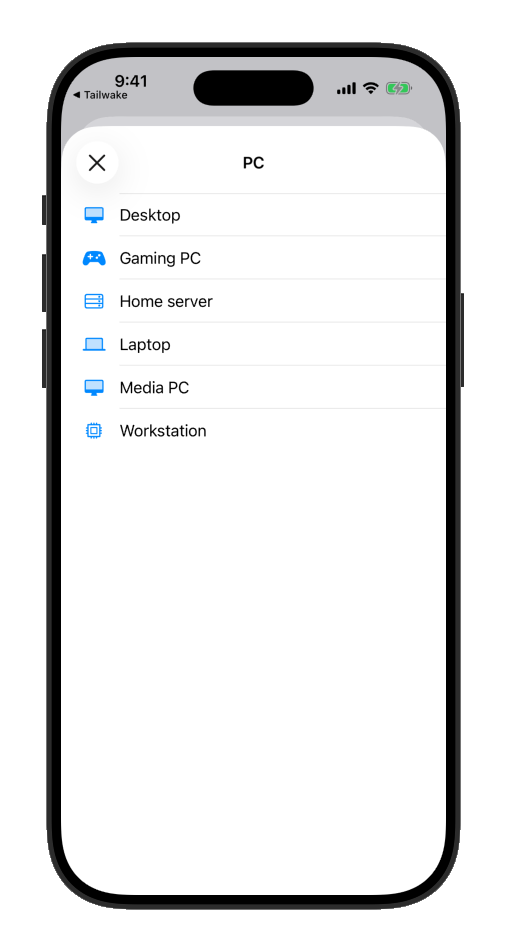
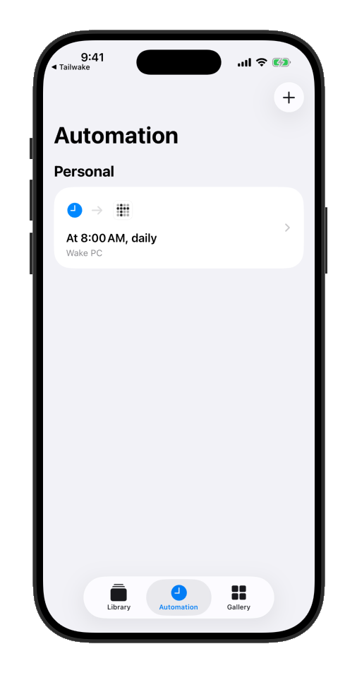

# Automate wakes

[← Tailwake home](README.md) · [Instructions](INSTRUCTIONS.md) · [Support Development](SUPPORT.md) · [Privacy Policy](https://cp529414.github.io/Tailwake/privacy/) · [Terms of Use](TERMS.md)

[繁體中文](AUTOMATION.zh-Hant.md)

Tailwake donates a **Wake PC** action to Siri and Shortcuts for every saved PC, so you can wake one without opening the app — by voice, on a schedule, or from another shortcut.

**Automation requires Tailwake Pro and an active plan.** Monthly, yearly, and lifetime access all enable Siri and Shortcuts. The check applies to local and remote wakes, including existing shortcuts and scheduled automations. Basic offers unlimited manual wakes.

Tailwake checks access each time the action runs, before sending a wake. If access has expired or is unavailable, the action returns an error; it does not open a purchase screen during an unattended automation. Purchase or restore from **Support Tailwake** in the app, then run the shortcut again. A verified eligible purchase can be used without first opening the app, subject to the device's normal security and network availability.

## Wake a PC by voice

Say **“Tailwake” followed by the PC's name** — for example, “Hey Siri, Tailwake Desktop” — to wake it hands-free.

This exact phrase works in any language Siri is set to, because it adds no extra words of its own: it's just Tailwake's app name (which is never translated) followed by the PC's name. That already works today if your device's Siri language is Traditional Chinese, and it will keep working in any language Tailwake adds in the future, without any change to the app.

If you'd rather use a full sentence, “Wake {PC}”, “Turn on {PC}”, and “Boot {PC}” also work in English.

## Create a daily wake automation

This walks through waking a saved PC — named “Desktop” here — automatically every morning at 8:00 AM, using the Shortcuts app's Personal Automations. Substitute your own PC's name and time.

1. Open **Shortcuts** and go to the **Automation** tab.

   

2. Tap **New Automation**, then choose **Time of Day**.

   

3. Set the time to **8:00 AM**, keep **Repeat** set to Daily, then tap **Next**.

   

4. Tap **Add Action**.

   

5. Scroll down to find **Tailwake** among your installed apps — no need to search.

   

6. Tap **Tailwake**, then tap **Wake PC…**.

   

7. Choose the PC to wake — **Desktop**, for this example.

   

8. The automation is ready.

   

The screenshots show an English-language example; Apple's Shortcuts screens and labels can vary by iOS version and language. If the automation uses **Run After Confirmation**, iOS asks before running it. To run without a confirmation prompt, open the automation settings and choose **Run Immediately**.

Apple Shortcuts manages scheduled wakes. See [Editions and Plans](SUPPORT.md) for Pro access.
