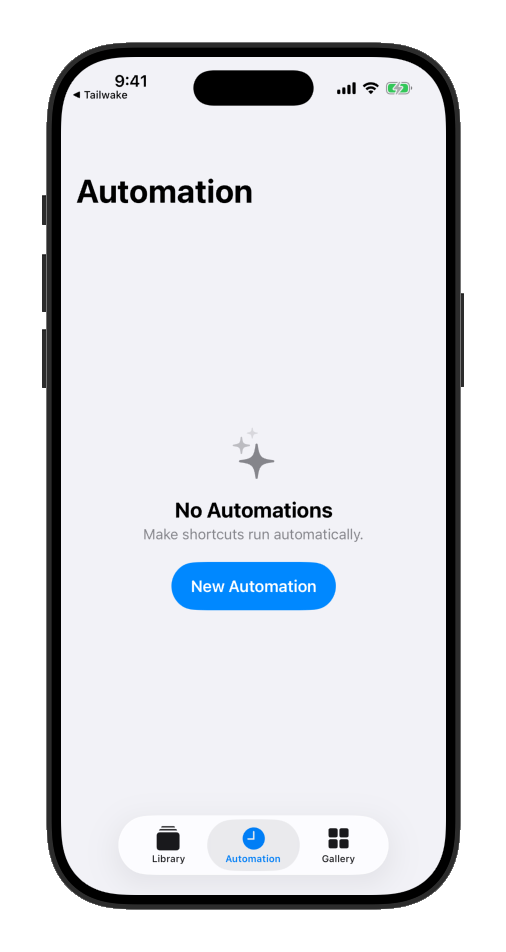
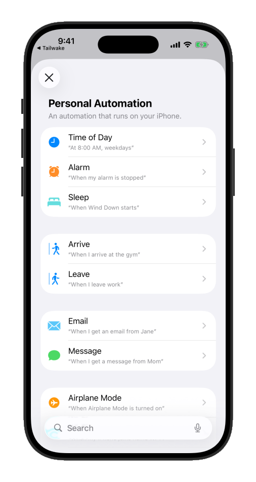
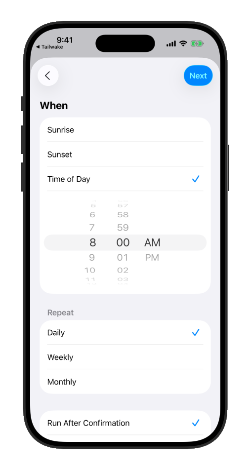
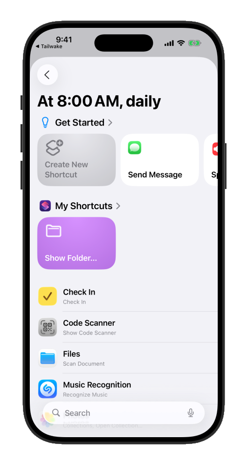
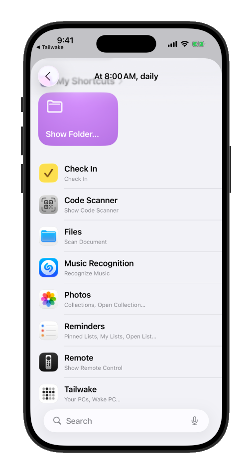
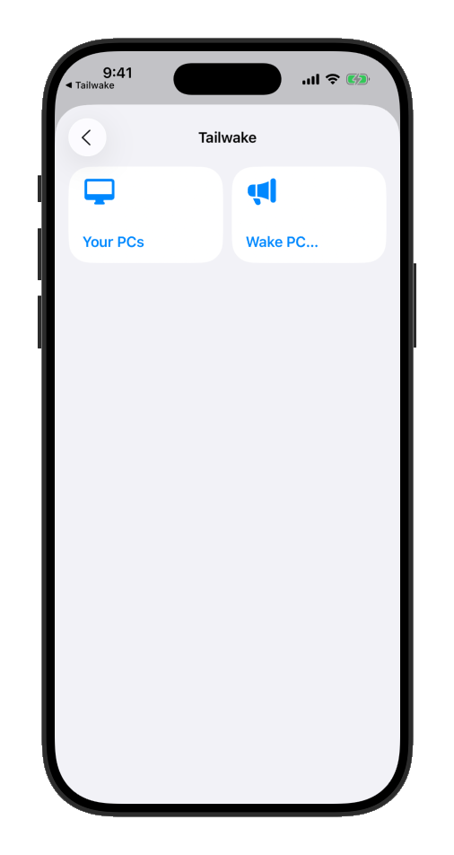
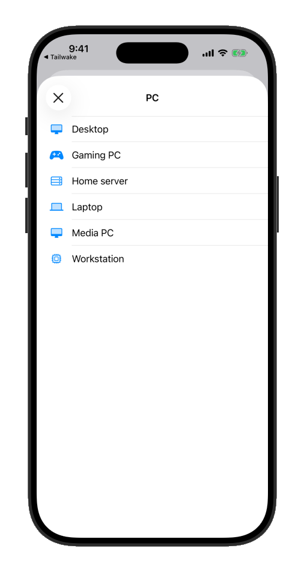
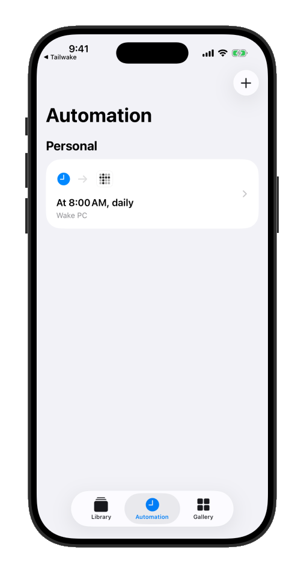

# 自動化喚醒

[← 首頁](README.zh-Hant.md) · [操作說明](INSTRUCTIONS.zh-Hant.md) · [支持開發](SUPPORT.zh-Hant.md) · [隱私權政策](https://cp529414.github.io/Tailwake/zh-Hant/privacy/) · [使用條款](TERMS.zh-Hant.md) · [English](AUTOMATION.md)

Tailwake 為已儲存的電腦提供 Siri 與 Apple「捷徑」的「喚醒電腦」（Wake PC）動作，可透過語音、排程或其他捷徑喚醒，而不必先開啟 App。

**自動化需要 Premium**：有效的月訂閱、年訂閱或終身解鎖。此要求適用於本地、遠端、既有已儲存的捷徑及排程自動化。免費使用者隨時可以開啟 Tailwake 手動喚醒，沒有次數上限。

每次執行動作時，Tailwake 都會在傳送喚醒前檢查權益。權益過期或無法確認時，動作會回傳錯誤，不會在無人操作的自動化中開啟購買畫面。請先在 App 的「支持 Tailwake」購買或回復購買，再執行捷徑。已驗證的有效購買不需先開啟 App 即可使用，但仍受裝置正常安全性限制及網路可用性影響。

## 透過 Siri 語音喚醒

說出 **「Tailwake」加上電腦名稱**，例如「嘿 Siri，Tailwake Desktop」。這個短語只包含不翻譯的 App 名稱及電腦名稱，可用於 Siri 的繁體中文設定。

英文也可使用「Wake {PC}」、「Turn on {PC}」及「Boot {PC}」等完整短語。

## 建立每日喚醒自動化

以下示範透過「捷徑」的個人自動化，在每天上午 8:00 喚醒名為 Desktop 的電腦。請換成您的電腦名稱與時間。

1. 開啟「捷徑」，進入「自動化」分頁。

   

2. 點選「新增自動化」，再選「特定時間」。

   

3. 設定上午 8:00，重複選「每天」，再點「下一步」。

   

4. 點選「加入動作」。

   

5. 在已安裝 App 清單中捲動至 Tailwake。

   

6. 點選 Tailwake，再選 **Wake PC…**（喚醒電腦）。

   

7. 選擇要喚醒的電腦，此例為 Desktop。

   

8. 自動化設定完成。

   

上述圖片為英文介面示例；Apple「捷徑」的畫面與名稱可能隨 iOS 版本及語言而不同。若設定為「確認後執行」，iOS 會先詢問您。若要不經詢問執行，請開啟自動化設定，將執行方式改成「立即執行」。

排程由 Apple「捷徑」管理，Tailwake 沒有獨立的喚醒排程器。Premium 方案、終身解鎖及自願贊助請見[支持開發](SUPPORT.zh-Hant.md)。
