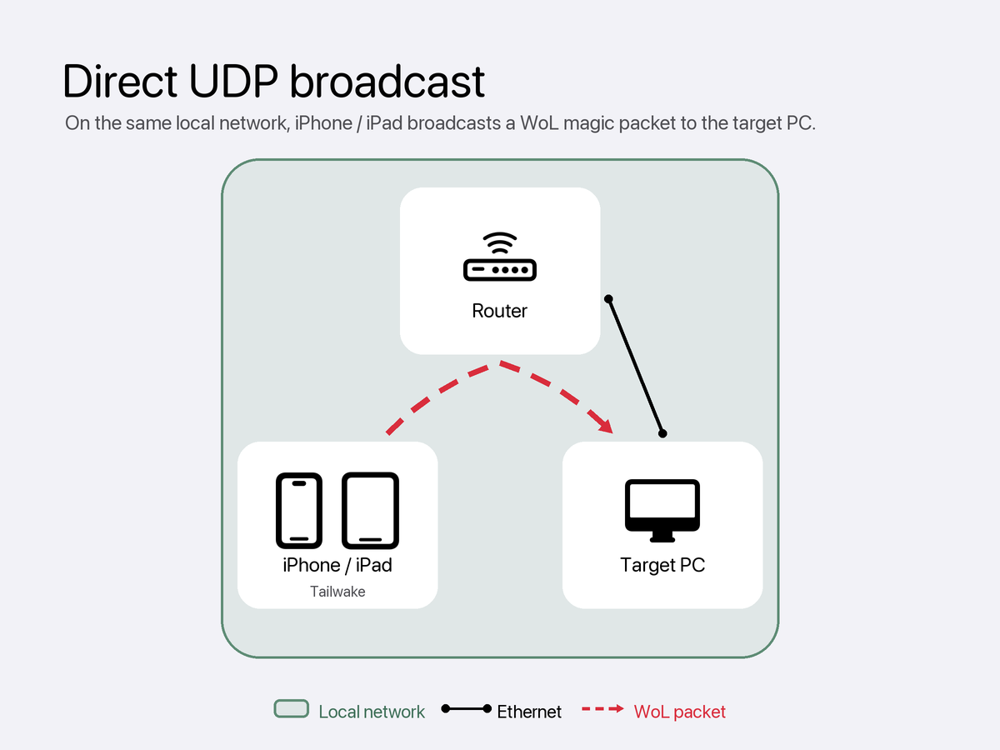
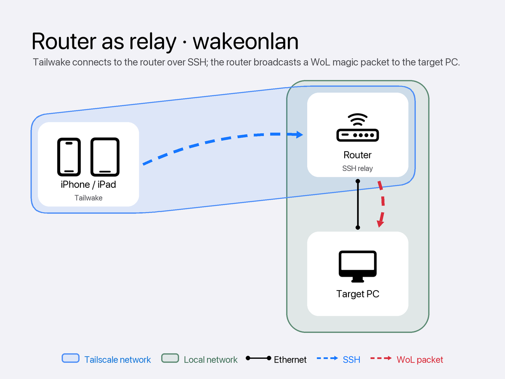
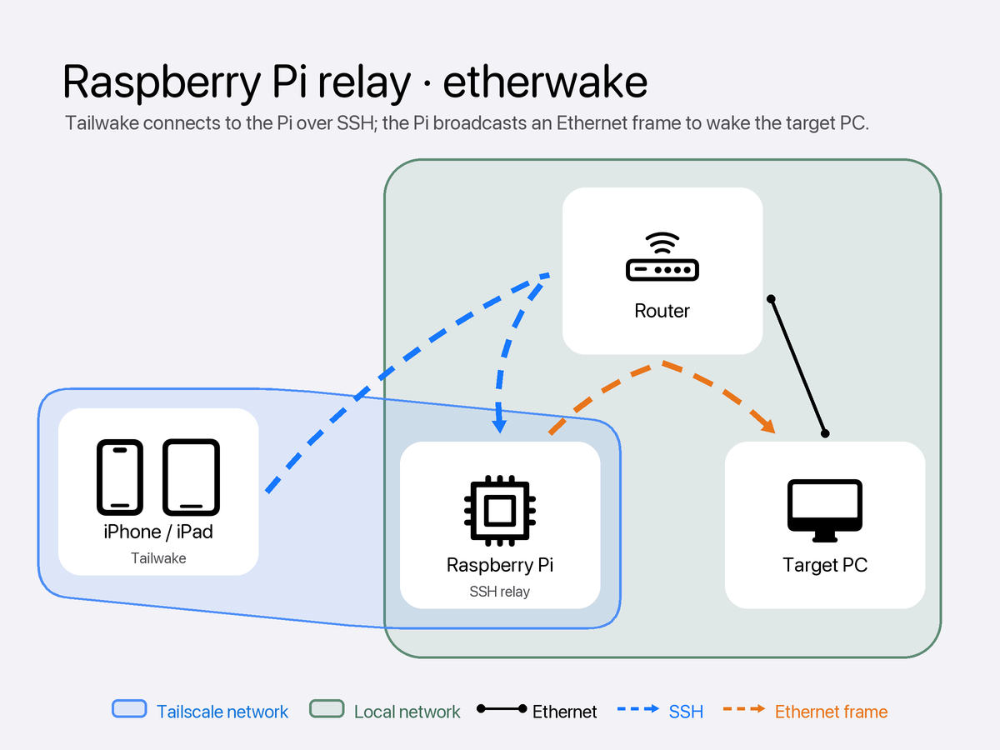
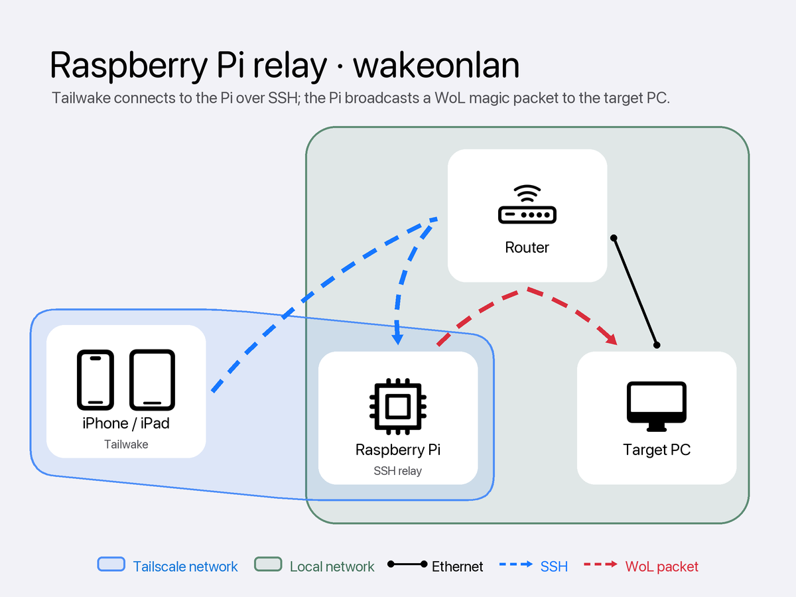

# Tailwake 操作說明

[← 首頁](README.zh-Hant.md) · [自動化喚醒](AUTOMATION.zh-Hant.md) · [支持開發](SUPPORT.zh-Hant.md) · [隱私權政策](PRIVACY.zh-Hant.md) · [使用條款](TERMS.zh-Hant.md) · [English](INSTRUCTIONS.md)

手動本地及遠端喚醒免費且不限次數。所有使用者都能新增電腦、設定 SSH 中繼、使用驗證及查看喚醒紀錄。Premium 提供 Siri 與「捷徑」自動化，並移除廣告。

## 開始前

您需要：

- 執行 iOS 17 或更新版本的 iPhone 或 iPad
- 支援 Wake-on-LAN 的電腦及網路卡
- 電腦的 MAC 位址
- 遠端喚醒另需一台位於電腦區域網路內、支援 SSH 的中繼裝置

請先在電腦韌體及作業系統設定中啟用 Wake-on-LAN。

Tailwake 會要求「區域網路」權限以傳送本地喚醒。通知為選用，可用來回報已傳送、失敗及後續驗證結果。

## 在同一網路喚醒

當 iPhone 或 iPad 與電腦位於同一區域網路，新增電腦時選擇 **Local (UDP)**。Tailwake 直接廣播 WoL 魔術封包，不需中繼裝置。

## 遠端喚醒

電腦所在區域網路內的路由器或小型 Linux 電腦可作為 SSH 中繼。選擇 **Relay (SSH)**，輸入中繼裝置的位址、連接埠、使用者、驗證方式及喚醒工具。中繼裝置收到 Tailwake 的 SSH 連線後，在電腦所在網路廣播喚醒封包。

### 使用路由器

路由器必須支援 SSH 並能執行選定的喚醒工具。OpenWrt 適合此用途；Asuswrt-Merlin、FreshTomato、DD-WRT 與 Gargoyle 在啟用 SSH 且具備所需工具時也可能適用。

### 使用小型 Linux 電腦

Raspberry Pi 是其中一種選擇。任何持續運作、具備 SSH 與喚醒工具，並能存取電腦所在廣播網段或 VLAN 的 Linux 單板電腦都可能適用。

### 選擇中繼工具

| 工具 | 傳送方式 | 中繼裝置需求 |
| --- | --- | --- |
| `etherwake` | 原始乙太網路訊框 | Root 權限及本地網路介面；支援 SecureOn |
| `wakeonlan` | UDP WoL 魔術封包 | 不需 Root 權限或選擇網路介面；不支援 SecureOn |

Tailwake 必須能連至中繼裝置，中繼裝置也必須能連至電腦所在的廣播網段或 VLAN。安裝缺少的工具前，App 會先顯示將執行的指令，並在您確認後才使用中繼裝置的套件管理工具安裝。安裝需要網際網路，可能也需要 Root 或免密碼 `sudo` 權限。

### SSH 驗證與安全性

可使用 SSH 密碼，或未加密的 OpenSSH Ed25519 私鑰。中繼裝置需提供 Ed25519 或 ECDSA SSH 主機金鑰；僅支援 RSA 或其他過舊協定的 SSH 伺服器需先更新。

首次成功連線後，Tailwake 會記住中繼裝置的 SSH 主機金鑰。若金鑰變更，App 會在提供密碼或私鑰前中止連線，並要求您比較新金鑰。

## 在 Tailwake 新增電腦

1. 開啟 Tailwake 並新增電腦。
2. 輸入名稱與 MAC 位址。
3. 同一網路選擇 **Local (UDP)**，遠端喚醒選擇 **Relay (SSH)**。
4. 使用中繼時，輸入 SSH 設定、選擇密碼或 Ed25519 私鑰，再選 `etherwake` 或 `wakeonlan`。
5. 可啟用驗證並輸入電腦上的 TCP 服務，例如遠端桌面的 3389 連接埠。
6. 正式依賴遠端功能前，先在電腦仍開機時測試設定與驗證，再測試待機喚醒。

## 驗證與紀錄

「喚醒前驗證」會檢查指定 TCP 位址及連接埠；電腦已回應時便略過喚醒。「喚醒後驗證」在選定的 1–60 分鐘延遲後檢查一次，預設為五分鐘。

「喚醒紀錄」將每次嘗試、後續驗證及中繼工具安裝結果保存在裝置上。不開啟 App 的語音或排程喚醒請見[自動化喚醒](AUTOMATION.zh-Hant.md)。

廣告載入失敗或您的廣告同意選擇都不會阻擋手動喚醒。Premium、終身解鎖及自願贊助請見[支持開發](SUPPORT.zh-Hant.md)。
